# 🧠 Edge-Optimized CNNs for Medical Image Classification

[](LICENSE)
[](https://www.python.org/)
[](https://tensorflow.org/)
[]()
[]()

An empirical study and benchmark of **resource-constrained Convolutional Neural Networks (CNNs)** designed for edge computing devices (microcontrollers, Raspberry Pi, and low-power IoT sensor nodes). 

This project explores the tripartite trade-offs between **model capacity**, **computational complexity (MACs/FLOPs)**, and **classification performance** on an Alzheimer’s MRI binary classification dataset downscaled to $64 \times 64$ sensor-grade resolution.

---

## Executive Summary & Key Findings

| Metric | Model A (Baseline CNN) | Model B (Ultra-Lightweight) | MobileNetV2 (Transfer) | EfficientNet-B0 (Transfer) |
| :--- | :---: | :---: | :---: | :---: |
| **Architecture Type** | Standard Conv2D | Depthwise Separable | Inverted Residuals | Compound Scaled MBConv |
| **Total Parameters** | 228,418 | **64,290** | 2,260,546 | 4,052,133 |
| **Trainable Parameters** | 228,418 | **63,330** *(<100k limit)* | 2,192,322 (Stage 2) | 3,968,094 (Stage 2) |
| **Weight Size (FP32)** | 892.26 KB | **251.13 KB** *(−72%)* | 8.62 MB | 15.46 MB |
| **Estimated MACs** | 14.88 M | **8.00 M** *(−46%)* | 24.45 M | 31.97 M |
| **Inference Latency (CPU)** | **0.93 ms** | 1.56 ms | 4.62 ms | 9.13 ms |
| **Test Accuracy** | **96.67%** | **92.71%** | 87.60% | **92.71%** |
| **Demented Precision / Recall**| 97.86% / 95.42% | 94.18% / 91.04% | 84.91% / 91.46% | 93.99% / 91.25% |
| **Non-Demented Precision / Recall**| 95.53% / 97.92% | 91.33% / 94.38% | 90.75% / 83.75% | 91.50% / 94.17% |

### Core Takeaways:
1. **Ultra-Lightweight Efficiency:** **Model B** satisfies strict edge hardware budgets (< 100k parameters), reducing memory footprint by **72%** (251 KB) and compute operations by **46%** (8.00M MACs) compared to the baseline, while sustaining an **92.71% test accuracy**.
2. **Custom Edge vs. Heavy SOTA Models:** Massive transfer learning backbones (MobileNetV2: 2.26M params, EfficientNet-B0: 4.05M params) did **not** outperform our custom edge design on $64 \times 64$ resolution. EfficientNet-B0 matched Model B at 92.71% accuracy but required **63× more parameters** and **4× more MACs**, highlighting that standard ImageNet architectures can be excessively heavy and prone to domain mismatch for low-resolution edge sensor streams.
3. **Optimizer Dynamics:** In convergence experiments on Model B, **Adam ($\text{lr}=10^{-3}$)** rapidly converged to >90% accuracy within 10 epochs. Plain SGD struggled at 75.21% accuracy, while adding moderate momentum ($\text{momentum}=0.5$) boosted SGD test accuracy to 87.40%. Excessive momentum ($0.9\text{--}0.99$) induced destabilizing oscillations around steep loss contours.

---

## Comprehensive Visualizations & Trade-Offs

### 1. The Edge Trade-Off Triangle
Comparison of Accuracy vs. Memory Footprint (Parameters) and Computational Burden (MACs):

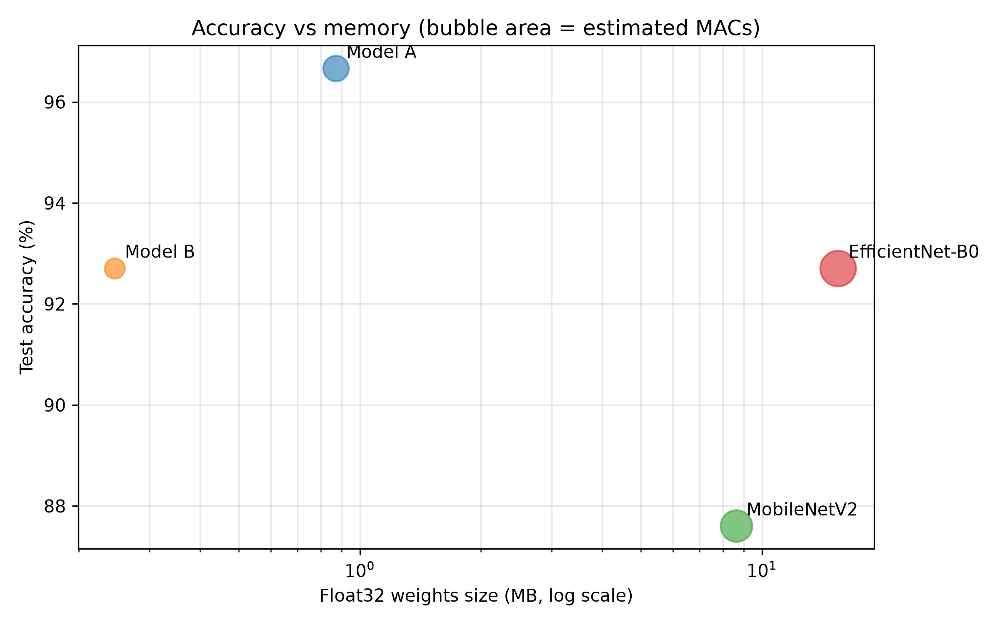

### 2. Optimizer Convergence Study
Comparison of loss trajectories across optimizers (Adam vs. SGD vs. SGD+Momentum) and momentum values ($\mu \in [0.0, 0.5, 0.9, 0.99]$):

| Optimizer Comparison | Momentum Hyperparameter Sweep |
| :---: | :---: |
| 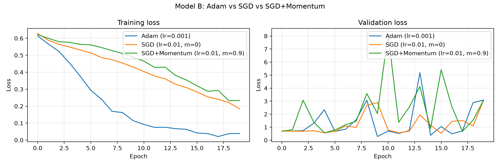 | 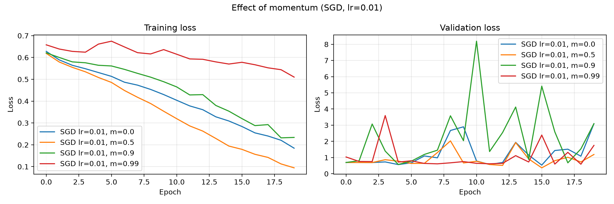 |

### 3. Model Learning Curves & Confusion Matrices
Validation trajectories and test split classification confusion matrices:

| Model | Learning Curves | Confusion Matrix |
| :--- | :---: | :---: |
| **Model A** *(Baseline CNN)* | 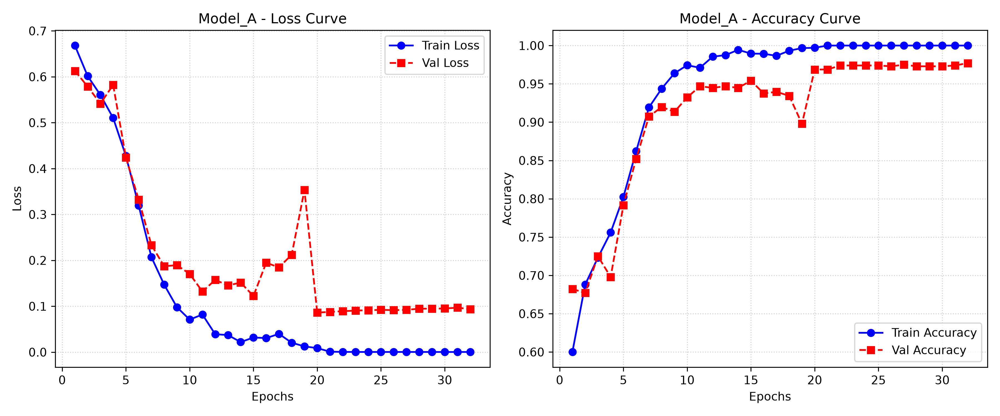 | 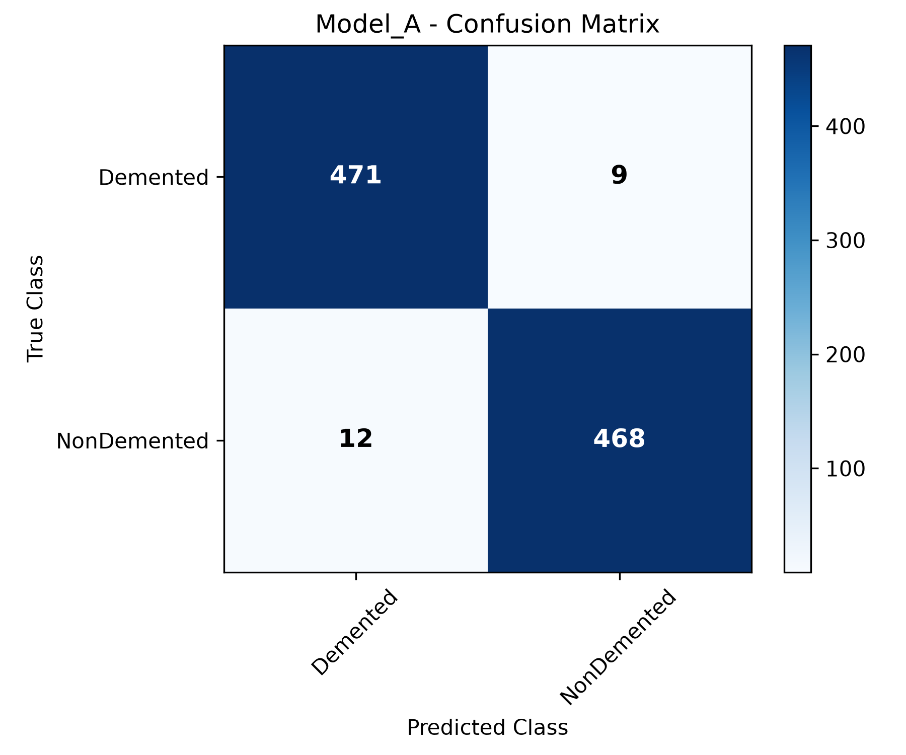 |
| **Model B** *(Edge Separable CNN)* | 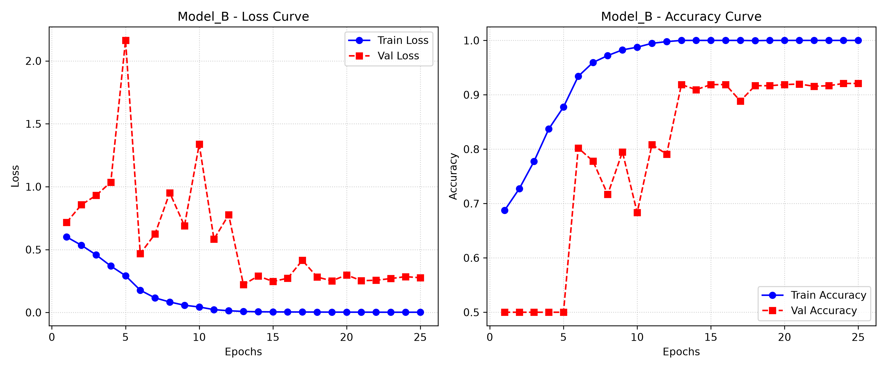 | 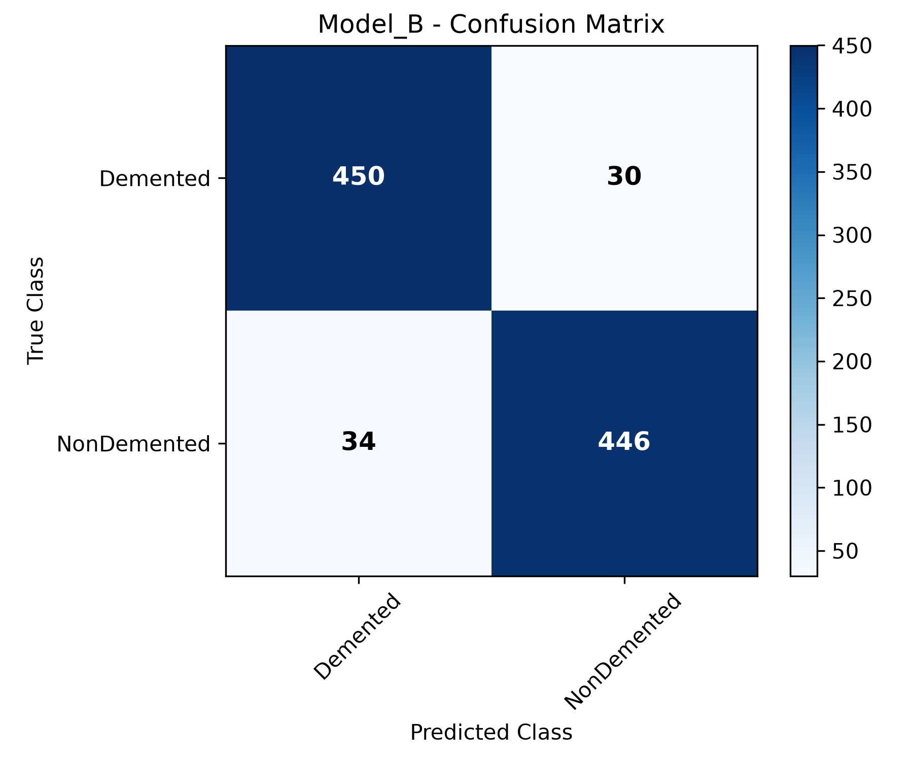 |
| **MobileNetV2** *(Transfer)* | 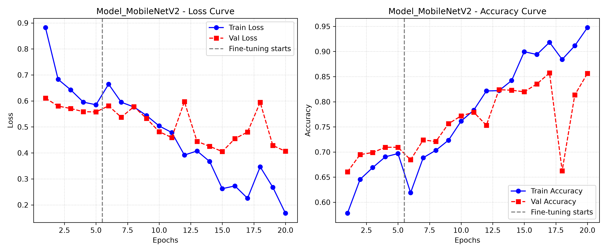 | 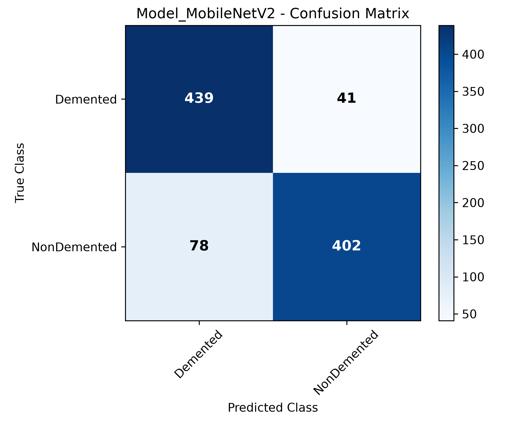 |
| **EfficientNet-B0** *(Transfer)* | 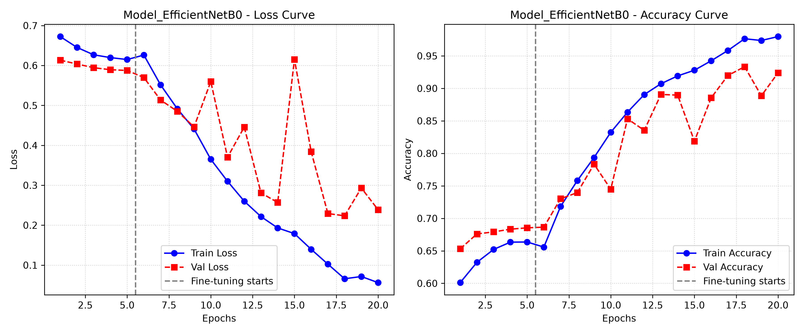 | 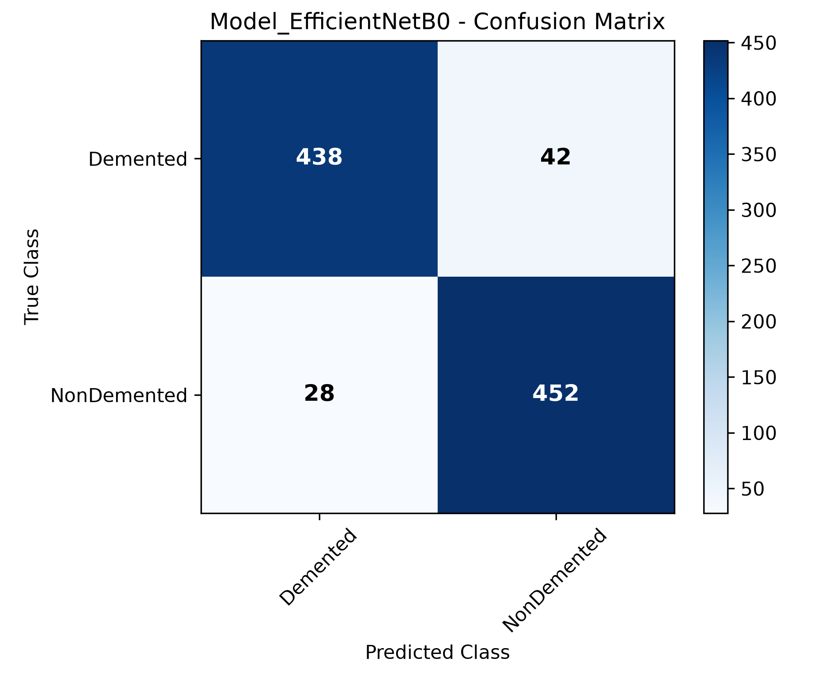 |

---

## Architectural Design & Hardware Rationales

### Model A: Standard Baseline CNN ([src/model_a.py](src/model_a.py))
- **Topology:** Four cascading standard convolution blocks ($16 \to 32 \to 64 \to 128$) with $3 \times 3$ kernels, `ReLU` activation, and `MaxPooling2D`.
- **Classification Head:** `Flatten` $\to$ `Dense(64)` $\to$ `Dropout(0.3)` $\to$ `Dense(2, Softmax)`.
- **Characteristics:** High discriminative accuracy (96.67%), but higher MAC count (14.88M) and parameter count (228k), with a dense classifier prone to larger weight files.

### Model B: Resource-Constrained Edge CNN ([src/model_b.py](src/model_b.py))
- **Depthwise Separable Convolutions:** Replaces standard 2D convolutions with `SeparableConv2D` ($32 \to 64 \to 128 \to 256$), factorizing spatial convolution into depthwise spatial filtering followed by pointwise ($1 \times 1$) cross-channel projection. This yields an algorithmic **85–90% reduction in MACs** per layer.
- **Global Average Pooling (GAP):** Replaces memory-heavy `Flatten` operations with `GlobalAveragePooling2D`. This drastically minimizes dense layer weights and guards against spatial overfitting.
- **Hardware-Aware Activation Functions:** Exclusively uses single-instruction piecewise-linear `ReLU` activations rather than transcendental functions (`Sigmoid`, `Tanh`), avoiding expensive polynomial or exponential floating-point approximations on hardware lacking dedicated FPUs.
- **Batch Normalization:** Stabilizes internal covariate shifts across separable layers and accelerates training convergence.
- **Parameter Footprint:** **64,290 total parameters** (63,330 trainable), strictly complying with hard edge constraints (< 100,000 parameters).

### SOTA Transfer Benchmarks ([src/sota_models.py](src/sota_models.py))
- **MobileNetV2 & EfficientNet-B0:** Pretrained on ImageNet and adapted to $64 \times 64$ grayscale input (replicated across 3 channels).
- **Two-Stage Fine-Tuning:**
  - *Stage 1:* Backbone frozen; only the custom classification head is trained ($\text{lr} = 10^{-3}$).
  - *Stage 2:* Entire backbone unfrozen (with BatchNorm kept in inference mode) and fine-tuned at a lower learning rate ($\text{lr} = 10^{-4}$).

---

## Repository Structure

```text
CNN-Img-classification/
├── data/
│   ├── OriginalDataset/            # Raw Alzheimer's MRI dataset (unprocessed)
│   │   ├── NonDemented/
│   │   ├── VeryMildDemented/
│   │   ├── MildDemented/
│   │   └── ModerateDemented/
│   └── processed/                  # Balanced 64x64 splits (70% train / 15% val / 15% test)
│       ├── train/                  # 4,480 images (2,240 Demented, 2,240 NonDemented)
│       ├── val/                    # 960 images (480 Demented, 480 NonDemented)
│       └── test/                   # 960 images (480 Demented, 480 NonDemented)
├── docs/                           # Documentation and specifications
├── models/                         # Saved trained checkpoints (.keras format)
├── reports/
│   ├── figures/                    # Benchmark plots & confusion matrices
│   ├── final_comparison.json       # Side-by-side metrics across all four models
│   ├── optimizer_results.json      # Epoch-by-epoch loss & accuracy for optimizer study
│   └── sota_results.json           # Fine-tuning logs & metrics for MobileNetV2 / EfficientNet
├── src/
│   ├── prepare_dataset.py          # Resizes raw images to 64x64 & generates 70/15/15 splits
│   ├── model_a.py                  # Model A architecture definition (Standard Baseline)
│   ├── model_b.py                  # Model B architecture definition (Edge Separable CNN)
│   ├── train.py                    # Training & evaluation pipeline for Model A & B
│   ├── optimizer_study.py          # Empirical optimizer comparison & momentum sweep
│   ├── sota_models.py              # Architecture adapters for MobileNetV2 and EfficientNet-B0
│   ├── train_sota.py               # Two-stage transfer learning fine-tuning pipeline
│   └── compare_models.py           # Automated evaluation, MAC estimation & trade-off plotting
├── .gitignore                      # Git ignore patterns for datasets and binary weights
├── requirements.txt                # Python package dependencies
└── README.md                       # Main project documentation
```

---

## Getting Started & Execution Guide

### 1. Prerequisites
- **Python:** Version 3.10 or higher
- **Virtual Environment:** Recommended (`venv` or `conda`)

### 2. Installation

Clone this repository and create a virtual environment:

```bash
# Clone the repository
git clone https://github.com/RumethRanhinda/CNN-Img-classification.git
cd CNN-Img-classification

# Create virtual environment
python -m venv .venv

# Activate environment:
# On Windows (PowerShell):
.venv\Scripts\Activate.ps1
# On macOS / Linux:
source .venv/bin/activate

# Install dependencies
pip install -r requirements.txt
```

---

### 3. Step-by-Step Pipeline Execution

#### Step 3.1: Dataset Preparation
Place the raw Alzheimer's MRI dataset into `data/OriginalDataset/` with the original 4 subfolders (`NonDemented`, `VeryMildDemented`, `MildDemented`, `ModerateDemented`).

Run the automated preprocessing and splitting script:
```bash
python src/prepare_dataset.py
```
* **Actions:** Resamples images to $64 \times 64$ using Lanczos interpolation, maps multi-stage dementia into a balanced binary task (`Demented` vs. `NonDemented`), and creates reproducible 70% / 15% / 15% train, validation, and test splits with fixed seed `42`.

#### Step 3.2: Train Custom Models (Model A & Model B)
Train both custom models end-to-end:
```bash
python src/train.py --model both --epochs 30 --batch_size 32
```
* *Options:*
  * `--model a` : Train only the baseline CNN.
  * `--model b` : Train only the edge-optimized CNN.
  * `--no-early-stopping` : Disable dynamic early stopping and train for all specified epochs.
* *Outputs:* Saves model files in `models/` and generates learning curves & confusion matrices in `reports/figures/`.

#### Step 3.3: Run the Optimizer Study
Evaluate how optimizer selection and momentum settings impact convergence on Model B:
```bash
python src/optimizer_study.py --epochs 20
```
* *Outputs:* Generates `reports/figures/optimizer_comparison.png`, `reports/figures/momentum_sweep.png`, and serializes trajectory logs to `reports/optimizer_results.json`.

#### Step 3.4: Fine-Tune SOTA Transfer Models
Fine-tune MobileNetV2 and EfficientNet-B0 on the exact same $64 \times 64$ split:
```bash
python src/train_sota.py --model both
```
* *Outputs:* Executes Stage 1 (head training) and Stage 2 (unfrozen fine-tuning), saves model files to `models/`, and writes metrics to `reports/sota_results.json`.

#### Step 3.5: Run Unified Comparative Benchmarking
Run the automated comparative benchmarking script to measure parameter counts, estimated MACs, single-image inference latencies, and classification statistics:
```bash
python src/compare_models.py
```
* *Outputs:* Generates `reports/final_comparison.json` and updates the comprehensive trade-off graph `reports/figures/final_tradeoff.png`.

---

## In-Depth Analysis & Findings

### Why Did Custom Model B Compete So Well With SOTA Models?
1. **Low Resolution Compatibility:** SOTA architectures like EfficientNet-B0 and MobileNetV2 were specifically engineered and hyper-tuned for $224 \times 224$ or $256 \times 256$ inputs with deep receptive fields. When forced onto $64 \times 64$ images, aggressive spatial downsampling through multiple stride-2 stages leaves subsequent layers operating on extremely small spatial maps ($2 \times 2$ or $1 \times 1$), diluting architectural benefits.
2. **Over-Parameterization on Limited Data:** With millions of parameters, deeper networks require substantial regularization and pretraining alignment. On a focused medical binary classification dataset, Model B's compact capacity (64k parameters) acts as an inherent regularizer, preventing severe over-fitting without requiring heavy computational overhead.
3. **Inference Latency Considerations:** Although Model B requires significantly fewer MACs (8.00M vs. 14.88M) than Model A, standard CPU implementations of Depthwise Separable Convolutions can incur memory bandwidth overhead due to low arithmetic intensity (fewer arithmetic operations per memory fetch). However, on specialized edge accelerators (such as Google Edge TPU, ARM Ethos, or ESP32-S3 with ESP-NN), depthwise separable convolutions unlock dramatic power and latency savings.

---

## License & Citation

This project is open-source under the [MIT License](LICENSE).

Developed as part of the **EN3150 - Pattern Recognition** course at the **University of Moratuwa**, Department of Electronic and Telecommunication Engineering.

If you find this benchmark or architectural comparison useful in your work, feel free to cite or star this repository!
